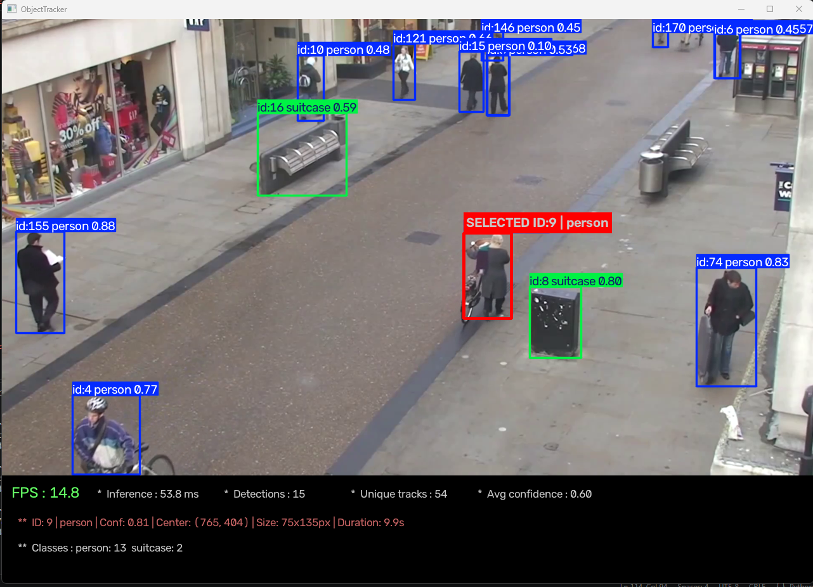

# YOLOv26 Object Tracker



Real-time object detection and tracking using **YOLOv26** and **BoT-SORT**, with interactive mouse-based object selection.

### Features
- Real-time object detection and tracking with persistent track IDs.
- Click to select or deselect tracked objects.
- Highlight selected objects with bounding boxes.
- Live metadata panel displaying FPS, inference time, detection counts, class distribution, confidence, and selected-object details.
- Supports video files and RTSP IP camera streams.

### Requirements
- Python
- OpenCV
- PyTorch
- Ultralytics

### Usage
Configure the model path and video source in the script, then run:

```bash
python main.py
```

Press **Q** to exit.